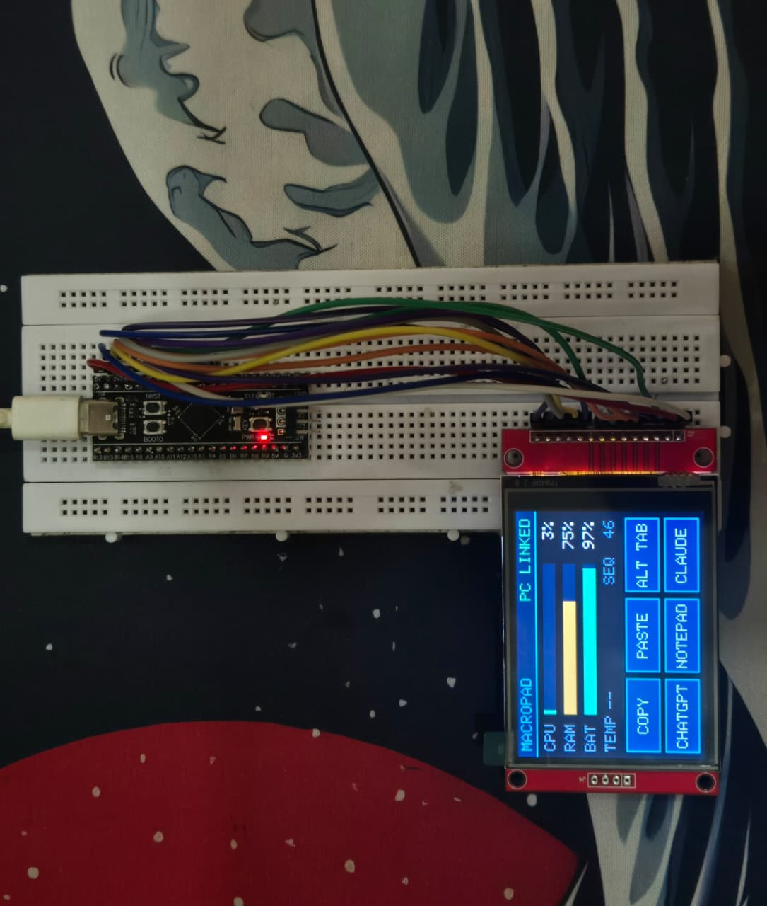
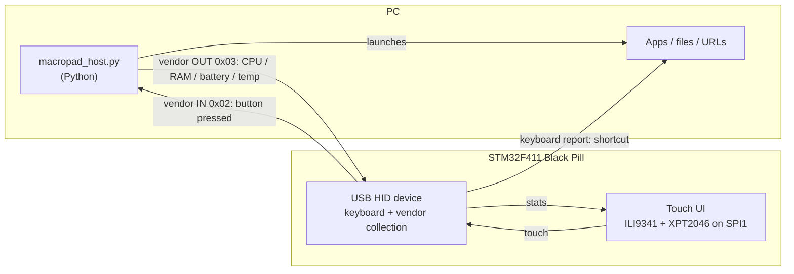
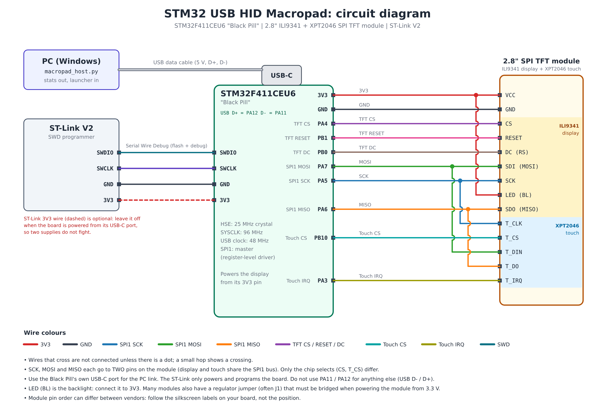
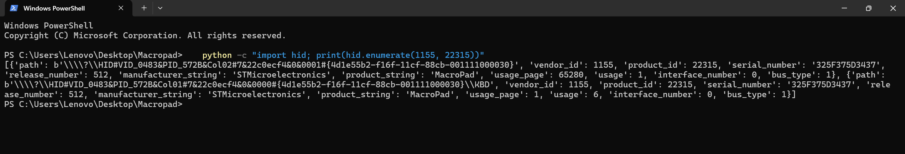
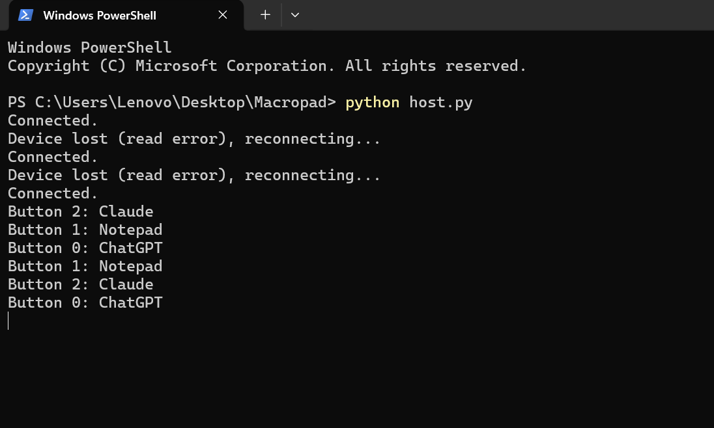
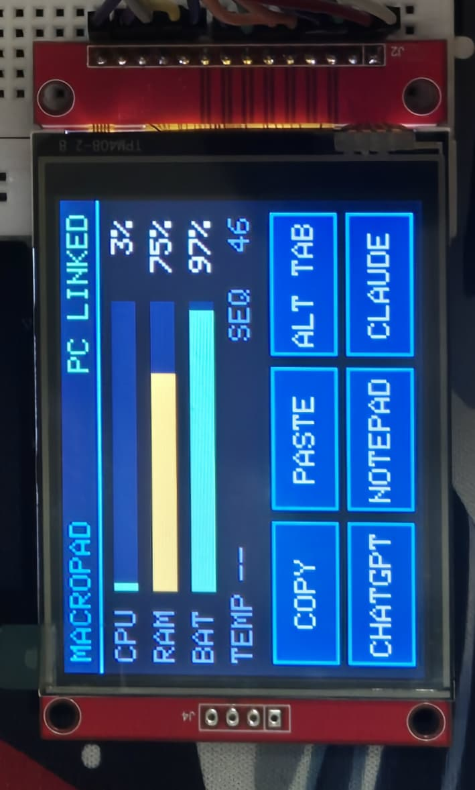
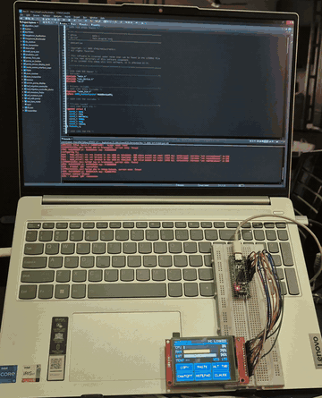

# STM32 USB HID Macropad

A USB macropad built on an **STM32F411 "Black Pill"** with a **2.8" touchscreen**. Touch buttons on the screen send keyboard shortcuts or **launch apps, files and URLs on the PC**, while a Python host script streams **live CPU / RAM / battery / temperature** stats back to the display over the same USB cable.



## Features

- **Composite USB HID device**: a standard keyboard plus a vendor-defined 64-byte report channel, on one USB cable.
- **Touchscreen UI** (ILI9341 + XPT2046, 320 x 240 landscape) with six touch buttons.
- **Two kinds of button**
  - *Shortcut* buttons (COPY, PASTE, ALT+TAB ...) send a real HID keyboard report and need **no software on the PC**.
  - *Launch* buttons tell the PC host script to open any app, file, URL or command, which a plain keyboard cannot do.
- **Two-way link**: the PC sends CPU, RAM, battery and temperature once per second, and the screen shows a `PC LINKED` / `NO DATA` indicator.
- **Hot-reloaded button map** (`actions.json`): change what a button launches without reflashing the board; the host script reconnects by itself if the USB cable is unplugged.
- **Register-level SPI1 driver** for the display and touch controller, with a 5-sample median touch filter and an **on-screen 3-point calibration with a check pass**.


## How it works



1. **Shortcut button**: the firmware sends a keyboard report (modifier + key), and the PC treats it like any keyboard.
2. **Launch button**: the firmware sends a "button N pressed" report on the vendor channel. The host script looks up button N in `actions.json` and runs the mapped action.
3. **Stats**: the host script sends a stats packet every second. The firmware draws the bars and treats missing packets as "no link".

The full byte layout of every report is in [docs/protocol.md](docs/protocol.md).

## Hardware

| Part | Notes |
|---|---|
| STM32F411CEU6 "Black Pill" | USB device on the board's own USB-C port (PA11 / PA12) |
| 2.8" SPI TFT module | ILI9341 display + XPT2046 touch controller on one board |
| ST-Link V2 | For flashing and debugging over SWD |
| USB data cable | Must carry data, not charge-only |

### Wiring

The touch controller shares the SPI bus with the display, so SCK, MOSI and MISO each go to **two** pins on the module.

| Display module pin | Black Pill pin |
|---|---|
| VCC | 3V3 |
| GND | GND |
| CS | PA4 |
| RESET | PB1 |
| DC (RS) | PB0 |
| SDI (MOSI) and T_DIN | PA7 |
| SCK and T_CLK | PA5 |
| SDO (MISO) and T_DO | PA6 |
| LED (backlight) | 3V3 |
| T_CS | PB10 |
| T_IRQ | PA3 |

More detail, including programmer wiring and pitfalls, is in [docs/wiring.md](docs/wiring.md).



## Repository layout

```
.
├── firmware/                  STM32CubeIDE project (see firmware/README.md)
├── host/                      PC side for the STM32 macropad (Python)
│   ├── macropad_host.py         stats sender + button launcher
│   ├── actions.json             button number -> action
│   └── test_host.py             dry run with fake button reports
└── docs/                      protocol, wiring, bring-up, calibration, troubleshooting
```

## Getting started

### 1. Build and flash the firmware

See [firmware/README.md](firmware/README.md). In short: open the project in STM32CubeIDE, build, and flash through the ST-Link. Then check the device shows up (see [docs/bring-up.md](docs/bring-up.md)):

```
python -c "import hid; print(hid.enumerate(1155, 22315))"
```

You should see **two** entries: a keyboard interface (`usage_page` 1) and the vendor interface (`usage_page` 65280).



### 2. Run the host script

```
cd host
pip install -r requirements.txt
python macropad_host.py
```

You should see `Connected.`; within about a second the screen switches to `PC LINKED` and the bars start moving.



### 3. Choose what each button does

Edit `host/actions.json`. The key is the button's `app` number in the firmware (`ui.c`), and the script reloads the file when you save it.

```json
{
  "0": { "name": "Browser",    "type": "url", "target": "https://www.google.com" },
  "1": { "name": "Notepad",    "type": "app", "target": "notepad.exe" },
  "2": { "name": "Calculator", "type": "app", "target": "calc.exe" }
}
```

| `type` | What it does | `target` |
|---|---|---|
| `app` | Runs a program (optional `"args": [...]`) | Path to an `.exe` |
| `file` | Opens a file or folder with its default program | File or folder path |
| `url` | Opens a web page in the default browser | URL |
| `command` | Runs any shell command | Command line |

On Windows, apps installed as packaged (Store-style) apps have no normal `.exe` path. Look up their AppID with PowerShell and launch them through Explorer:

```powershell
Get-StartApps | Where-Object Name -like "*AppName*"
```
```json
{ "name": "My app", "type": "command", "target": "explorer.exe shell:AppsFolder\\<AppID>" }
```

### 4. Calibrate the touch panel

Hold a finger on the screen while the board powers up (or set `UI_FORCE_CAL` to 1 once). Tap the three crosses, then the check crosses. The result screen shows five values to paste into `touch.h`. Details: [docs/calibration.md](docs/calibration.md).


## Results





## Design notes

- **HAL where it pays off, registers where it is simple.** The clock tree and the USB device stack use ST's HAL and USB Device middleware, because a USB stack is a big, well-tested piece of code. The display and touch drivers on SPI1 are written at register level.
- **Why two collections.** The keyboard collection (Report ID 1) is what the OS accepts as a keyboard with no driver. The vendor collection (Report IDs 2 and 3) is the private channel to the host script. On Windows the two show up as separate HID devices, and the host picks the vendor one by its usage page (`0xFF00`).
- **Why a launch channel at all.** A USB keyboard can only press keys, so opening an arbitrary app by faking keystrokes is fragile (it depends on the OS search and on timing). Telling a host script to run the app is reliable and works for anything Python can start.
- **Touch filtering.** Each touch point is the median of five readings, and a reading is rejected if the five disagree by more than 300 counts, so a finger that is landing or moving does not trigger a button.

## Testing

| What | How |
|---|---|
| Host script logic without the board | `cd host && python test_host.py` (dry run) or `python test_host.py --real` (actually launches the mapped actions) |
| Board bring-up on hardware | [docs/bring-up.md](docs/bring-up.md) |


## Tested on

- Windows 11 (host script and launching apps). 
- STM32CubeIDE 1.19.0 with an ST-Link V2.
- Python 3.8.4

The host script uses cross-platform libraries, but Linux and macOS have not been tested.

## Troubleshooting

See [docs/troubleshooting.md](docs/troubleshooting.md): empty `hid.enumerate()`, "Device Descriptor Request Failed", USB failing while the debugger has the CPU halted, apps that fail to launch, and more.

## Limitations and ideas

- The calibration is stored at compile time (copied into `touch.h`), not in flash. Saving it to flash at runtime would let the board recalibrate itself without a rebuild.
- The 3-point calibration corrects scale and offset on each axis but not panel rotation. A full affine calibration would handle a skewed panel. (The check pass shows when that matters.)
- The six-button layout is fixed in firmware (`macros[]` in `ui.c`).
- Tested on Windows only.

## License

[MIT](LICENSE).
