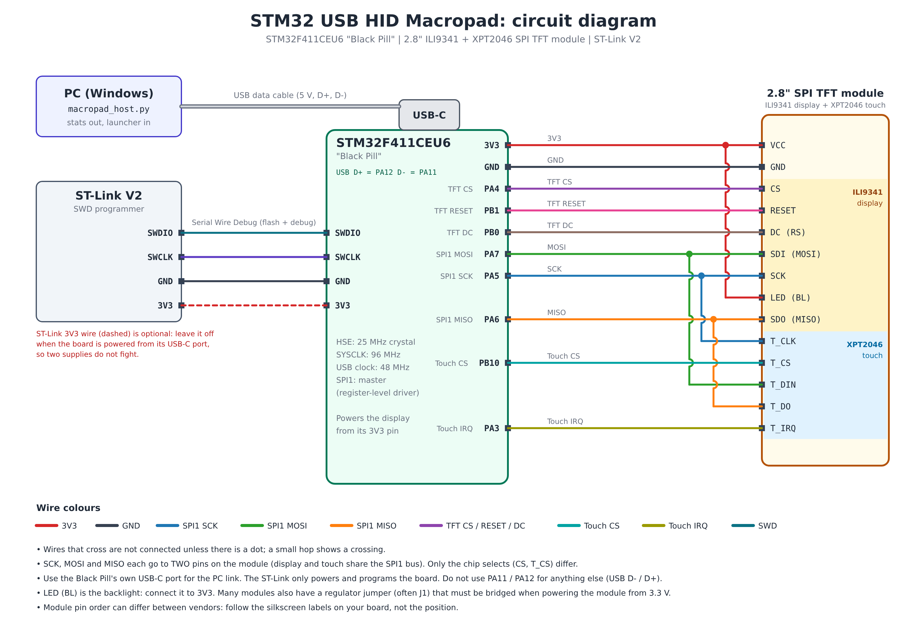

# Wiring

## Display and touch (shared SPI1 bus)

The 2.8" module has an ILI9341 display controller and an XPT2046 touch controller. They share the SPI bus: **SCK, MOSI and MISO each go to two pins on the module** and only the chip selects differ.

| Display module pin | Black Pill pin | Notes |
|---|---|---|
| VCC | 3V3 | Use 3.3 V |
| GND | GND | |
| CS | PA4 | TFT chip select |
| RESET (RST) | PB1 | |
| DC (RS, D/C) | PB0 | |
| SDI (MOSI) | PA7 | |
| SCK | PA5 | |
| LED (BL) | 3V3 | Backlight |
| SDO (MISO) | PA6 | |
| T_CLK | PA5 | Same wire as SCK |
| T_CS | PB10 | Touch chip select |
| T_DIN | PA7 | Same wire as MOSI |
| T_DO | PA6 | Same wire as MISO |
| T_IRQ | PA3 | Goes low while the screen is touched |

Notes:

- Many red 2.8" modules have a small solder jumper near the on-board regulator (often labeled J1). When you power the module from 3.3 V this jumper usually has to be bridged. If the screen stays dark with correct wiring, check this first.
- **Do not use PA11 and PA12**: they are the USB data lines.
- The pin assignments live in `tft.h` and `touch.h`. If you change a pin, change it there.

## Programmer (ST-Link V2, SWD)

| ST-Link | Black Pill |
|---|---|
| SWDIO | SWDIO |
| SWCLK | SWCLK |
| GND | GND |
| 3V3 | 3V3 |

If you power the board from its USB-C port at the same time, leave the ST-Link's 3V3 wire disconnected so two supplies do not fight each other.

## USB to the PC

Use the **Black Pill's own USB-C port** for the PC link. The ST-Link only powers and programs the board: the USB data pins (PA11 / PA12) are available only on the board's connector.

